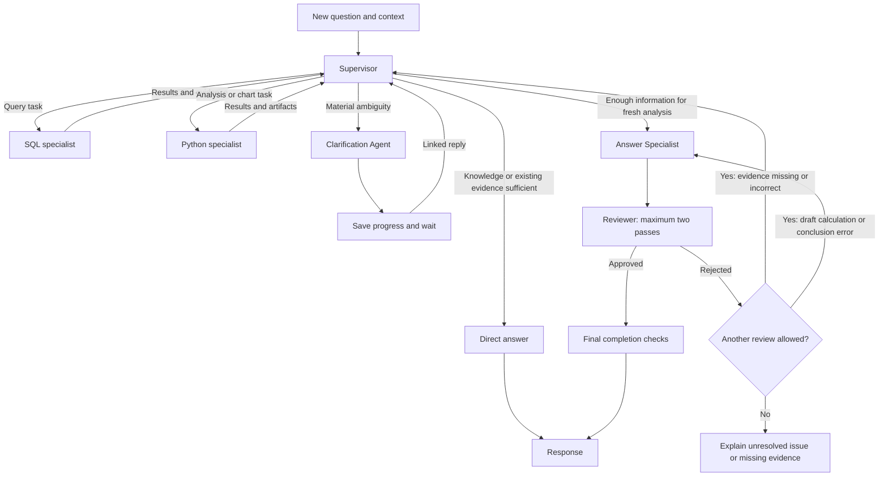

# Querivue architecture

Working draft · 7 November 2026

## Confirmed foundations

### Agent boundary

The agent is an independent Python package in `agent/`. Its CLI and the Django background worker import the same package. The package owns routing, clarification, specialist coordination, analysis tools, and verification. Django owns application persistence and the HTTP API.

Keep the agent callable without starting Django. The CLI supplies its inputs directly. The application worker resolves the run's recorded dataset scope and passes the relevant inputs to the agent. Interface types and lifecycle contracts will be defined as this document is refined.

### Local and hosted Postgres

Docker Compose runs Postgres locally. The eventual hosted setup uses Supabase Postgres. Django migrations define the application schema in both environments.

Postgres holds Projects, Datasets, Chats, messages, run records, source relationships, and references to saved files. The agent performs analytical queries over prepared uploads inside the execution sandbox.

### Shared local storage

Use a persistent Docker volume for uploaded files, prepared datasets, and artifacts. The Django API and background worker mount the same volume. Store file references and metadata in Postgres.

Retain stored data until the user deletes it under the PRD's source-removal rules. Give each sandbox only the inputs authorized for its run. Keep persistent output copies outside the sandbox so later runs and recovery can retrieve them.

## Supervisor coordination

### Action model

Represent actions with a Pydantic Action model as well as the already agreed Task models. The shared Action fields are action_id (UUID) and type (the action discriminator). Concrete discriminator values, specialist-specific payloads, and any action subclasses will be defined with the concerned components. How terminal and clarification actions record outcomes and transition the graph is a pending design decision.

### Per-action outcomes

Final outcome field naming and granularity: use outcomes, a list with one outcome per executed action, rather than task_outcomes or action_outcomes. Tasks still group independent actions. This supersedes the earlier task-level outcome collection decision. The proposed per-action fields (parent task ID, executed action, status, result or error), exact status values, and retry-attempt linkage remain to be finalized with execution and specialist contracts. Successful action evidence remains available when another action in the same task fails.

### Task models and outcome collection

Task model decision: define a Pydantic task base class and subclasses for different task types. pending_tasks is an ordered queue/list of task objects. next_task holds the full selected task object, not merely a task ID reference, and conceptually uses the task base type. task_outcomes is a list of outcome records, each containing the task, its status, and its result or error. This supersedes the earlier task-reference and dictionary-of-outcomes proposals. Concrete subclass payloads, polymorphic validation/serialization, task selection/removal lifecycle, outcome status vocabulary, and additional outcome fields remain open.

### Current task terminology

Terminology update: a task is a group of independent actions that may run concurrently. pending_tasks is the revisable ordered plan of such tasks; next_task selects the next task; task_outcomes retains completed outcomes separately from pending work. This supersedes the earlier batch terminology: former batches are now tasks, and former individual specialist tasks are now actions. Prior payload and outcome examples are not approved schemas. Whether next_task embeds a task or references it, how outcomes group action results, and how direct-answer, clarification, and answer-handoff decisions are represented remain open. Finalize these contracts before implementation.

Each submitted question has its own run state. A linked clarification reply resumes that original run. A new turn creates another run and can carry relevant confirmed context from earlier work.

The supervisor can return a Direct answer using general knowledge or verified context in its current model call. Data claims require evidence. Trace the two forms separately.

Use a bounded ReAct-style supervisor implemented with LangGraph. The supervisor owns initial routing, analysis planning, and delegation. It can answer general questions, reuse verified evidence, or invoke SQL and Python specialists for fresh analysis. This supersedes the earlier separate Router Agent design.

Specialists return observations to the supervisor. For fresh analysis, once it has gathered enough information, an Answer Specialist drafts the response from the evidence. The draft must pass the Reviewer before display. Missing or incorrect computed evidence returns the run to the supervisor. If evidence is sufficient but the draft has a calculation or conclusion error, return it to the Answer Specialist. Allow at most two review passes in total across the run, including the initial review. If the second review rejects the answer, end with a brief explanation of the unresolved verification issue and omit the rejected analysis. If evidence is missing, explain which claim could not be supported and what evidence is needed, using the reviewer findings. This supersedes the single-correction policy. When a review finds both evidence issues and draft errors, evidence issues take precedence and the run returns to the supervisor, subject to the two-pass limit. The reviewer reports only blocking problems with correctness, evidence, or fulfillment of the request. Wording and style preferences remain with the Answer Specialist. The Clarification Agent suspends work when user input is needed. Code enforces source access, budgets, and completion checks.

### Supervisor run context

The runtime supplies run_context before invoking the agent; it is read-only to the supervisor. The CLI supplies equivalent context without requiring Django. Preserve the original question here; the representation of interpreted intent and clarification-derived definitions remains open for memory and task-contract design. Eligible sources define the pinned access scope, while task evidence separately records sources actually used. The runtime checks authorization and source availability when dispatching work. Newly added datasets do not enter an existing run's scope; clarification resumes the same scope.

| Field | Type | Meaning |
| --- | --- | --- |
| run_id | UUID | Identifies this submitted question's run. |
| project_id | UUID | Identifies the Project containing its datasets. |
| chat_id | UUID | Identifies the Chat containing the question. |
| question | string | Original user question, preserved unchanged. |
| eligible_dataset_ids | list of UUIDs | Dataset snapshot IDs pinned at submission. |

UUID version, wire serialization, and CLI identifier conventions remain open. Other proposed supervisor state fields remain subject to their individual design discussions.

### Supervisor next action

Store the supervisor's next decision in a structured next_action field in supervisor state. It contains the selected action and the fields required to carry it out. Graph routing and dispatch use this field. Each supervisor turn selects exactly one action. A single delegation action can contain a batch of independent specialist tasks. Define the schema for each action when designing its concerned specialist or component. The exact action vocabulary, validation behavior, and consumption lifecycle remain open.

### Supervisor execution boundary

The supervisor coordinates work without executing SQL or Python itself. It may inspect available dataset metadata and retrieve context. SQL and Python execution belong to their specialists.

### Specialist state and contracts

Each specialist has its own state. The supervisor supplies the inputs needed for its delegated task and receives its result. Define each specialist's state, input and result schemas, and mapping from supervisor state during that specialist's design discussion. The previously illustrated structured task payload remains a proposal; its fields are not approved.

### Failure handling and stopping

After a specialist task fails, the supervisor inspects the failure and may retry, change approach, or continue with available evidence within runtime-enforced limits. When further progress is impossible, return a useful supported partial answer where possible and explicitly identify what remains unanswered. Repeated actions without new evidence must stop with an explanation instead of continuing until timeout. Exact budgets, retry limits, and the definition of no progress remain open. Fresh partial analyses remain subject to the agreed Answer Specialist and Reviewer workflow and two-review limit.

### Evaluation-driven execution limits

Choose the final supervisor execution limits from reproducible evaluation results, comparing answer quality, task completion, latency, cost, and recovery behavior. The suggested values are evaluation candidates only: 12 supervisor decisions per run, 3 concurrent specialist tasks, 1 retry of an unchanged task for transient failures, 2 consecutive action rounds without progress, and 5 minutes of active execution excluding clarification waits. Neither these values nor the proposed no-progress criteria are final. Evaluation runs must still use explicit finite limits. The separately agreed maximum of two review passes remains confirmed.

### Completion without duplicated outcomes

Do not add a separate requested_outcomes field to supervisor state. The original question, pending_batches, and task_outcomes are sufficient for the current design. Before answer handoff, the supervisor checks the question against gathered results and remaining work; an empty queue alone does not establish completion. The representation of confirmed definitions and filters remains open for memory and task-contract design.

### Revisable batch plan

The supervisor maintains a revisable queue of task batches as its current plan. Tasks within a batch are independent and may execute concurrently within runtime capacity. A batch can run only when its dependencies are satisfied. After each batch returns its outcomes, the supervisor reassesses the evidence and may append, revise, or remove pending work, request clarification, or finish evidence gathering. Pending batches do not execute automatically; dispatch goes through the next_action decision. Keep completed task outcomes and their evidence separate from pending batches so replanning preserves gathered evidence. The queue can expand when more evidence is needed, subject to run limits. Exact queue schemas, dependency tracking, and checkpoint behavior remain open.

### Parallel delegation

At each action step, the supervisor reassesses which tasks can run independently and can delegate a parallel batch. Dependent work waits for the results it needs. Tasks have isolated outputs, and the execution layer enforces a shared run budget and concurrency capacity. The exact capacity remains open.

Define the supervisor's input context, specialist task and result contracts, and loop budgets in the following design rounds.

## Current project layout

| Directory | Responsibility |
| --- | --- |
| `agent/` | Independent agent package, CLI, and evaluation suite. |
| `backend/` | Django API, persistence, and background task integration. |
| `frontend/` | React and TypeScript interface. |
| `docs/` | PRD, decision log, architecture, and later specifications. |

Backend and agent dependencies use separate uv projects and virtual environments.

## Design completion checklist

Before implementing a component, resolve its consequential design choices and obtain agreement on its spec. Keep decisions visibly marked as agreed, proposed, or open. Record explicit defaults and their rationale. Describe request and result contracts, allowed actions, state transitions, data scope, dependencies, parallel result handling, failure and retry behavior, completion checks, limits, and acceptance scenarios. Settle each item in the component that owns it.

Confirm the supervisor's completion and reviewer policy, delegation contracts, specialist observations, partial failures, budgets, and model configuration during the remaining supervisor rounds. The broader agent and application memory policy has its own deferred discussion.

A new constraint discovered during implementation must be checked against the agreed spec. Record and resolve any consequential design change before coding that change.
## Decisions still open

- Background execution framework and broker configuration. Celery with Redis is the current proposal.
- Prepared dataset representation. One immutable DuckDB database file per Dataset is the current proposal.
- Progress delivery. Polling run status is the initial proposal. Decide whether the frontend needs live streamed events.
- Run and attempt state transitions, source deletion, retries, clarification resume, and checkpoint recovery.
- Execution sandbox configuration, resource limits, data access restrictions, and artifact validation.
- Agent interfaces, model configuration, and observability.
- A later detailed memory discussion covering the agent loop and the application, recent turns and older summaries, persisted history retrieval, checkpoint state, and Chat versus Project scope.
- Detailed Docker Compose services and environment configuration.

The PRD defines the agreed behavior and build phases. This draft records confirmed choices while the remaining architecture is discussed.
