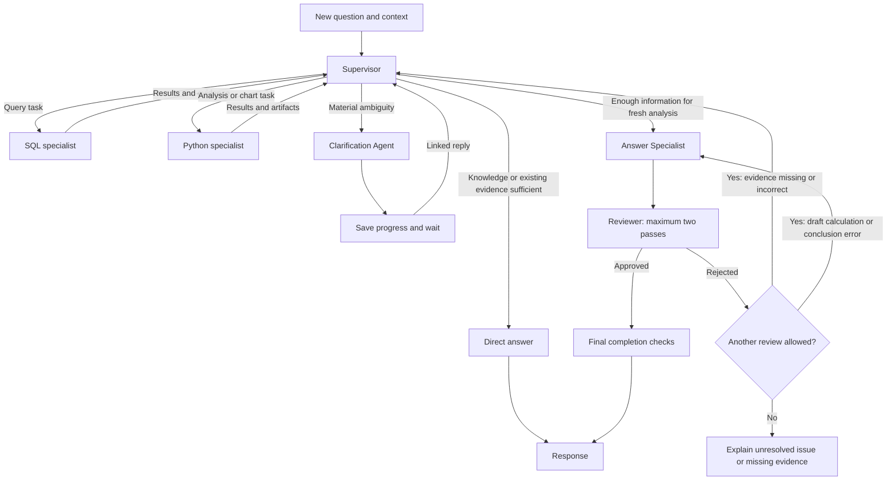

# Querivue architecture

Working draft · 7 November 2026

## Confirmed foundations

### Agent boundary

The agent is an independent Python package in `agent/`. Its CLI and the Django background worker import the same package. The package owns routing, clarification, specialist coordination, analysis tools, and verification. Django owns application persistence and the HTTP API.

Keep the agent callable without starting Django. The CLI supplies its inputs directly. The application worker resolves the run's recorded dataset scope and passes the relevant inputs to the agent. Interface types and lifecycle contracts will be defined as this document is refined.

### Local and hosted Postgres

Docker Compose runs Postgres locally. The eventual hosted setup uses Supabase Postgres. Django migrations define the application schema in both environments.

Postgres holds Projects, Datasets, Chats, messages, run records, source relationships, and references to saved files. The agent performs analytical queries over prepared uploads inside the execution sandbox.

### Shared local storage

Use a persistent Docker volume for uploaded files, prepared datasets, and artifacts. The Django API and background worker mount the same volume. Store file references and metadata in Postgres.

Retain stored data until the user deletes it under the PRD's source-removal rules. Give each sandbox only the inputs authorized for its run. Keep persistent output copies outside the sandbox so later runs and recovery can retrieve them.

### Prepared datasets

Use a deterministic ingestion pipeline with trusted importer code for parsing, header detection, type inference, validation, and profiling. Resolve ambiguous import settings through the user confirmation preview. Analysis by the agent starts once the Dataset is ready. Use separate sandbox sessions for ingestion and analysis. Ingestion receives a staged upload and confirmed settings, and produces the prepared database, catalog, and warnings. Analysis receives authorized prepared snapshots and required prior results, and produces evidence, charts, and execution errors. The worker controls file transfer and saves reusable outputs to persistent storage before releasing a session. Inspect uploads for the preview in an isolated session and release that session while awaiting user confirmation. Use one sandbox per active analysis run and reuse its staged files across actions. Give each action a separate execution context and output directory. Persist reusable outputs after each action. Release the sandbox on clarification, completion, or timeout. Recovery creates a fresh session from saved files and checkpointed state. Use one DuckDB connection per SQL action, reuse it for that action's queries, schema inspection, and query corrections, and close it when the action finishes or fails. Concurrent SQL actions use separate connections. Trusted runtime code attaches the authorized prepared Dataset files read-only under controlled aliases and supplies those aliases and table schemas to the SQL Specialist. The runtime owns attachment setup and file path resolution. Each model-generated SQL execution call contains one analytical query, supporting CTEs, joins, aggregations, and window functions. Before execution, the runtime validates the parsed query against permitted tables and functions. Reject commands that modify data, attach files, load extensions, or change settings. Trusted code saves the complete query result as a typed Parquet artifact and returns a bounded preview, row count, column types, and evidence reference to the agent. Python actions can load the saved artifact when they need the full result. If a result exceeds the configured storage limit, report the limit so the specialist can narrow the query. Preview sizes and result limits remain open for evaluation. For each saved query result, record an evidence UUID, run/task/action identifiers and attempt number, executed SQL and parameter values, Dataset snapshots and tables actually referenced, artifact reference, row count, schema, and integrity checksum. Use this provenance to support review, reproduction, and source-removal invalidation. Exact field types and source-reference extraction remain open. The SQL parser, function policy, and sandbox enforcement remain open. Disable outbound internet access in ingestion and analysis sessions. The worker makes OpenRouter calls outside the sandbox and transfers authorized files through the sandbox service. Preinstall required libraries in the sandbox image and keep model credentials outside the sandbox. Make staged analysis inputs read-only. Actions write to their own temporary and output directories. The worker retrieves only declared outputs after validating their paths, types, and sizes. Give each sandbox only authorized inputs and required runtime files. Verify filesystem enforcement with the chosen provider. Enforce finite limits for sandbox CPU, memory, execution time, temporary disk, expanded input size, and output size in addition to the 50 MiB raw upload cap. If a limit is exceeded, return an explicit failure identifying that limit. Any reduction of data or sampling requires a deliberate decision because it can change the answer. Choose numerical limits through ingestion and analysis benchmarks. Provider enforcement and the exact concurrency mechanism remain open.

Prepare one immutable DuckDB database file per Dataset. The file contains all tables imported from that upload. CSV, TSV, flat JSON, JSON Lines, and Parquet each produce one table. Excel can produce multiple worksheet tables. Show worksheet names and let the user select worksheets before ingestion, with all non-empty visible worksheets selected by default. Show hidden worksheets with a Hidden label and leave them unselected unless the user explicitly includes them. SQLite contributes the selected tables. For each selected worksheet, propose a header row and show a small preview. Let the user confirm or change the header row before table ingestion. Import one rectangular table per selected worksheet. When a worksheet contains multiple tables, ask the user to select the cell range for the table to import in the preview. For a worksheet containing one table, infer its range without requiring range selection. Allow merged titles outside the imported table. If a merged range intersects the imported header or data, flag its location and require the user to fix the worksheet before importing that table. For formulas in the selected table, import their saved results. If a formula has no saved result or contains an Excel error, show its cell location and require recalculation and saving of the workbook before importing that table. Explain in the preview that saved formula results are used and can be stale. The formula importer library and multi-table detection rules remain open. Store the prepared file on the shared persistent volume and record its reference and metadata in Postgres. A replacement upload receives a new Dataset ID and prepared database. Generate unique SQL column names for blank or duplicate headers. Preserve original header labels and source column positions in the catalog, and show the mapping in the import preview. The minimum table catalog records a stable table ID and SQL name, the source worksheet and selected range or SQLite table where applicable, original column labels, SQL column names, source positions, confirmed types, row count, per-column null counts, and import warnings. Exact catalog field types and table naming rules remain open. Show inferred column types in the import preview and allow users to override them. Validate proposed types against the complete selected table before publishing the Dataset. Mark a Dataset ready only after every selected table passes validation and preparation succeeds. If any selected table fails, keep the Dataset unavailable for analysis. Let the user fix the issue or deselect the affected table and resubmit before publication. Retain failed staged uploads until the user retries or deletes them. Allow retry with revised import settings using the stored upload, and count its raw bytes toward the project upload limit while retained. Build and validate the prepared DuckDB database inside the sandbox, transfer the completed file to temporary persistent storage, verify the transfer, and place it at its final immutable path. Save the catalog and file reference before marking the Dataset ready. A crash before readiness leaves it unavailable for analysis. Recovery can verify the saved file and finish publication or rebuild it. Associate each ingestion attempt with the confirmed import settings and allow only the current attempt to publish. Repeated delivery after successful publication returns the existing result. A late attempt cannot overwrite or invalidate newer preparation. Delete temporary files belonging to failed or superseded ingestion attempts once those attempts are confirmed inactive. Retain the staged upload for retry under its agreed retention rule, and retain the published DuckDB snapshot until Dataset deletion. Exact attempt identity, detailed publication mechanics, inactive-attempt detection, and cleanup timing remain open. For mixed or ambiguous values, show a warning and propose a conservative type that preserves the source values, including meaningful leading zeros in identifiers. If a selected type conversion fails, block import of the affected table and show the failure count and sample source locations. The user can choose a compatible type or correct the source. Exact inference and conversion rules, error display limits, normalization and collision rules, table naming, catalog schema, sandbox staging, and connection security remain to be designed.

## Supervisor coordination

### Action model

Represent actions with a Pydantic Action model as well as the already agreed Task models. The shared Action fields are action_id (UUID) and type (the action discriminator). Concrete discriminator values, specialist-specific payloads, and any action subclasses will be defined with the concerned components. How terminal and clarification actions record outcomes and transition the graph is a pending design decision.

### Per-action outcomes

Use outcomes, a dictionary keyed by action_id. Each key holds the latest recorded outcome for that action. A task completes when each of its action IDs has a terminal outcome for the current dispatch, including failures and timeouts. Preserve successful sibling outcomes and retry only the failed action when a retry is warranted. Use at-least-once crash recovery: reuse checkpointed outcomes and replay unresolved actions when eligible. An action may have run before its outcome was saved, so make replayed effects idempotent or deduplicate them with a stable action identity. Keep action_id stable and give each deliberate retry after a recorded failure a new attempt number. The runtime accepts outcomes only for the expected attempt and checks task completion against that attempt. Crash recovery replays an unresolved attempt with the same number so effects can be deduplicated by action ID and attempt number. Supervisor state keeps the latest outcome and expected attempt number for each action. Keep earlier attempt history in traces for debugging, subject to the agreed trace data rules. Exact outcome fields and replay mechanics remain open.

### Task models and outcome collection

Task model decision: define a Pydantic task base class and subclasses for different task types. pending_tasks contains only waiting tasks. Its first entry is next. On dispatch, the runtime moves the full task from the head of pending_tasks to current_task. After all actions have recorded outcomes, the runtime clears current_task and the supervisor reassesses the queue before another dispatch. Detailed recovery and retry mechanics remain open. Concrete task payloads and polymorphic validation and serialization remain open. 

### Current task terminology

A task groups independent actions that may run concurrently. The supervisor can revise the ordered pending_tasks queue between dispatches. The outcomes dictionary keeps completed action outcomes separate from pending and active work. Direct answer, clarification, and answer handoff contracts remain open. 

Each submitted question has its own run state. A linked clarification reply resumes that original run. A new turn creates another run and can carry relevant confirmed context from earlier work.

The supervisor can return a Direct answer using general knowledge or verified context in its current model call. Data claims require evidence. Trace the two forms separately.

Use a bounded ReAct-style supervisor implemented with LangGraph. The supervisor owns initial routing, analysis planning, and delegation. It can answer general questions, reuse verified evidence, or invoke SQL and Python specialists for fresh analysis. This supersedes the earlier separate Router Agent design.

Specialists return observations to the supervisor. For fresh analysis, once it has gathered enough information, an Answer Specialist drafts the response from the evidence. The draft must pass the Reviewer before display. Missing or incorrect computed evidence returns the run to the supervisor. If evidence is sufficient but the draft has a calculation or conclusion error, return it to the Answer Specialist. Allow at most two review passes in total across the run, including the initial review. If the second review rejects the answer, end with a brief explanation of the unresolved verification issue and omit the rejected analysis. If evidence is missing, explain which claim could not be supported and what evidence is needed, using the reviewer findings. This supersedes the single-correction policy. When a review finds both evidence issues and draft errors, evidence issues take precedence and the run returns to the supervisor, subject to the two-pass limit. The reviewer reports only blocking problems with correctness, evidence, or fulfillment of the request. Wording and style preferences remain with the Answer Specialist. The Clarification Agent suspends work when user input is needed. Code enforces source access, budgets, and completion checks.

### Supervisor run context

The runtime supplies run_context before invoking the agent; it is read-only to the supervisor. The CLI supplies equivalent context without requiring Django. Preserve the original question here; the representation of interpreted intent and clarification-derived definitions remains open for memory and task-contract design. Eligible sources define the pinned access scope, while task evidence separately records sources actually used. The runtime checks authorization and source availability when dispatching work. Newly added datasets do not enter an existing run's scope; clarification resumes the same scope.

| Field | Type | Meaning |
| --- | --- | --- |
| run_id | UUID | Identifies this submitted question's run. |
| project_id | UUID | Identifies the Project containing its datasets. |
| chat_id | UUID | Identifies the Chat containing the question. |
| question | string | Original user question, preserved unchanged. |
| eligible_dataset_ids | list of UUIDs | Dataset snapshot IDs pinned at submission. |

UUID version, wire serialization, and CLI identifier conventions remain open. Other proposed supervisor state fields remain subject to their individual design discussions.

### Supervisor control decisions

The supervisor selects work through pending_tasks and the runtime dispatches the queue head into current_task. The graph determines what to execute from the actions in current_task. Action types and recorded outcomes drive the transitions, including graph-enforced mandatory review after a fresh draft. A separate routing decision field is unnecessary. An action that pauses or ends the run must be the sole action in its task, so it cannot interrupt sibling actions. Before dispatch, the runtime validates the proposed task. If the task is invalid, the runtime rejects it before any action starts and tells the supervisor which rule it violated. The supervisor can repair the plan within its normal decision budget. If that budget is exhausted, follow the agreed stopping rules. Concrete task and action schemas, remaining validation rules, and the validation error format will be defined with the relevant components. 

### Supervisor decision inputs

For each decision, give the supervisor the original question, relevant conversation context, metadata for eligible datasets, the pending plan, bounded summaries of action outcomes, and the remaining run budget. This defines the decision input, not additional persisted state fields. The memory design owns conversation context assembly.

### Evidence reuse and routing examples

Reuse prior evidence for a direct answer only when it supports the requested claim under the same dataset snapshots, metric definition, filters, period, and level of detail. Use few-shot examples in the supervisor prompt to demonstrate matching evidence reuse, fresh analysis when evidence is incompatible or insufficient, and clarification when ambiguity materially changes the answer. Ask for clarification only when the question and confirmed context leave a choice unresolved and choosing among plausible interpretations could materially change the answer. If plausible interpretations lead to the same substantive answer, proceed. Design the prompts, including the few-shot examples, after the component designs are complete. Refine the examples using routing evaluations.

### Supervisor execution boundary

The supervisor coordinates work without executing SQL or Python itself. It may inspect available dataset metadata and retrieve context. SQL and Python execution belong to their specialists.

### Specialist state and contracts

Each specialist has its own state. The supervisor supplies the inputs needed for its delegated task and receives its result. Define each specialist's state, input and result schemas, and mapping from supervisor state during that specialist's design discussion. The previously illustrated structured task payload remains a proposal; its fields are not approved.

### Failure handling and stopping

After a specialist task fails, the supervisor inspects the failure and may retry, change approach, or continue with available evidence within runtime-enforced limits. When further progress is impossible, return a useful supported partial answer where possible and explicitly identify what remains unanswered. Repeated actions without new evidence must stop with an explanation instead of continuing until timeout. Progress means obtaining usable new evidence, resolving an ambiguity, or completing a requested deliverable. A valid empty result counts when it answers a question about whether matching records exist. Repeating work that adds nothing does not reset the no-progress count. Exact budgets, retry limits, and the no-progress stopping threshold remain open for evaluation. Fresh partial analyses remain subject to the agreed Answer Specialist and Reviewer workflow and two-review limit. Reserve part of the run budget for drafting, review, and finalization. Before dispatching further analysis, enforce that reserve. When analysis reaches the reserve, hand off a useful supported partial answer if possible. If the evidence cannot support a useful answer, explain what is missing. Choose the reserve size through evaluation. Immediately before publishing any answer, check the run for source invalidation under the agreed source-removal rule and for expiration of the hard deadline. If either condition applies, withhold the answer and show the applicable source-unavailable or timeout message. Reviewer approval does not override these checks.

### Evaluation-driven execution limits

Choose the final supervisor execution limits from reproducible evaluation results, comparing answer quality, task completion, latency, cost, and recovery behavior. The suggested values are evaluation candidates only: 12 supervisor decisions per run, 3 concurrent specialist tasks, 1 retry of an unchanged task for transient failures, 2 consecutive action rounds without progress, and 5 minutes of active execution excluding clarification waits. These numerical values remain candidates for evaluation. Evaluation runs must still use explicit finite limits. The separately agreed maximum of two review passes remains confirmed.

### Completion without duplicated outcomes

Do not add a separate requested_outcomes field to supervisor state. Before answer handoff, the supervisor checks the original question against outcomes and remaining work in pending_tasks. An empty queue alone does not establish completion. The representation of confirmed definitions and filters remains open for memory and task-contract design.

### Revisable task plan

The supervisor can add, revise, reorder, or remove pending tasks between dispatches within run limits. A task can run only when its prerequisites are satisfied. Apply the existing retry policy to a failed prerequisite action. If it succeeds on retry, dependent work can proceed. If the action is ineligible for retry or its retries are exhausted, the supervisor uses the failure in outcomes to revise the plan. Before dispatch, the runtime blocks a queue head whose required results are missing and returns control to the supervisor. This prerequisite check does not trigger a retry. Keep outcomes separate from the queue so replanning preserves gathered evidence. Exact dependency tracking and checkpoint behavior remain open. 

### Parallel delegation

Between dispatches, the supervisor identifies independent actions that can run concurrently within one task. Dependent actions wait for the results they need. Actions have isolated outputs, and the execution layer enforces a shared run budget and concurrency capacity. The exact capacity remains open.

Define the supervisor's input context, specialist task and result contracts, and loop budgets in the following design rounds.

### Supervisor evaluation and observability

Evaluate both answer correctness and agent behavior. Use versioned fixtures with expected calculations and evidence, and check required and forbidden trajectory events for routing, evidence reuse, clarification, prerequisite ordering, retries, and review. Treat safety and recovery invariants as pass/fail gates. Compare the single-agent baseline and specialist configurations on shared fixtures for correctness, completion, active latency, tool calls, retries, and cost. Tune on development cases and use held-out cases for the final comparison.

Trace decisions, task and action dispatch, attempts, checkpoint resumes, reviews, and final outcomes. Correlate events with run, task, and action IDs and attempt numbers where applicable. Record concise decision labels, durations, outcomes, and stop reasons. Keep uploaded rows and raw results out of hosted traces. Publish a repeatable CLI evaluation and a report with configuration comparisons and annotated failure traces. Exact event fields, fixtures, and thresholds belong in the observability and evaluation specs.

### Agent inference and evaluation cost

Use OpenRouter for inference across all model-powered agent components, including the supervisor, specialists, and reviewer. Choose model configurations by role after evaluating candidates. Before running the full evaluation suite, forecast its cost using the planned cases, repetitions, expected token usage by role, and provider rates, with cache assumptions stated explicitly. After the run, report actual billed model usage and costs, including cached tokens and retries where applicable. Compare forecast with actual spend and report any separately billed evaluation costs, such as sandbox usage or external judges, within the same stated scope.

## Current project layout

| Directory | Responsibility |
| --- | --- |
| `agent/` | Independent agent package, CLI, and evaluation suite. |
| `backend/` | Django API, persistence, and background task integration. |
| `frontend/` | React and TypeScript interface. |
| `docs/` | PRD, decision log, architecture, and later specifications. |

Backend and agent dependencies use separate uv projects and virtual environments.

## Design completion checklist

Before implementing a component, resolve its consequential design choices and obtain agreement on its spec. Keep decisions visibly marked as agreed, proposed, or open. Record explicit defaults and their rationale. Describe request and result contracts, allowed actions, state transitions, data scope, dependencies, parallel result handling, failure and retry behavior, completion checks, limits, and acceptance scenarios. Settle each item in the component that owns it.

Confirm the supervisor's completion and reviewer policy, delegation contracts, specialist observations, partial failures, budgets, and model configuration during the remaining supervisor rounds. The broader agent and application memory policy has its own deferred discussion.

A new constraint discovered during implementation must be checked against the agreed spec. Record and resolve any consequential design change before coding that change.
## Decisions still open

- Background execution framework and broker configuration. Celery with Redis is the current proposal.
- Progress delivery. Polling run status is the initial proposal. Decide whether the frontend needs live streamed events.
- Run and attempt state transitions, source deletion, retries, clarification resume, and checkpoint recovery.
- Execution sandbox configuration, resource limits, data access restrictions, and artifact validation.
- Agent interfaces, model configuration, and observability.
- A later detailed memory discussion covering the agent loop and the application, recent turns and older summaries, persisted history retrieval, checkpoint state, and Chat versus Project scope.
- Detailed Docker Compose services and environment configuration.

The PRD defines the agreed behavior and build phases. This draft records confirmed choices while the remaining architecture is discussed.
