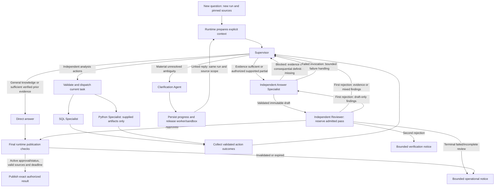

# Agent graph, memory and integration

15 November 2026. **Agenda and round 1 approved; round 2 shared state/identities is next.** Specialist contracts remain approved; this document assembles their existing boundaries and identifies the shared contracts still needed. The Floorplan blueprint visualizes the planned system, not implemented code. No new integration contract, file layout, coding or paid execution is approved by drawing it.

[Overall architecture](overall.md) · [Supervisor](supervisor.md) · [Project status review](../status-review.md) · [PRD](../PRD.md)

## Existing flow to preserve

These are logical responsibilities, not a decision about exact compiled LangGraph nodes, subgraphs or source filenames. The supervisor makes the first model decision for a new question. Runtime preparation and validation do not add a Router Agent.

Analysis actions can run concurrently only when independent and admitted by shared limits. A Python action needing SQL evidence waits for that result and a supervisor delegation; the diagram does not imply automatic SQL-to-Python routing. Answer/Reviewer receive explicit bounded contexts and do not share conversations. Direct answers retain their separate approved route; their exact terminal schema remains a review topic. No fresh draft can bypass mandatory review by relabeling itself Direct answer.

Two logical review passes are run-wide, nonrefundable once admitted/reserved. Evidence corrections produce new candidates; draft-only corrections return to Answer. Terminal operational review failure stops the flow even on pass 1. Recovery restores valid durable records rather than creating free reviews. All publication remains subject to source, ownership, active-candidate and deadline gates.

## Three kinds of retained information

| Kind | Existing boundary; remaining design |
| --- | --- |
| Conversational/analytical context | Relevant questions, confirmed definitions/filters, assumptions and reusable evidence references. Decide scope, selection, revision and bounded summaries; conversation text alone is not computed evidence or runtime authority. |
| Persistent graph checkpoints | Redis-backed progress for the standalone CLI, including fresh-process resume at milestone 1E. Decide concrete state/reducers/checkpoint reconciliation without treating checkpoints as authority to revive removed sources or reset budgets. |
| Durable records and artifacts | Transactional identities, outcomes, ownership, budgets, reviews and source validity; separately persisted tables/charts/code. Approved SQLite authority moves together to Postgres at integration. Decide canonical records/encoding and access/publication mechanics, not a competing memory database. |

The design must make each role's context inspectable: what it received, why it was eligible, which source dependencies it carries and what was unavailable. This does not mean every role receives the entire Chat or all Project data. Exact policy is intentionally not selected here.

## Approved review sequence

Work one consequential contract at a time; split a round when its decisions are independently reviewable. The agenda is kept in this specification rather than a temporary plan Markdown file.

| Round | Concrete deliverable |
| --- | --- |
| 1. Graph boundaries and control flow | Settle graph versus specialist subgraph responsibilities, dispatch/collection, correction edges, terminal/failure paths and placement of mandatory runtime gates. Preserve approved routes and independent agent decisions. |
| 2. Shared state and identities | Define run/task/action/control/outcome records, immutable references, state ownership and merge/reducer rules. Separate model proposals, derived context and authoritative runtime records; reuse component payloads and exact draft/review bindings. |
| 3. Memory scope and follow-ups | Decide Chat versus Project memory, original question versus interpreted intent, definitions/filter changes, assumptions/conflicts, prior-evidence eligibility, summaries/retrieval and deletion dependencies. Work through changed-filter, removed-source and concurrent-turn cases. |
| 4. Per-agent context construction | Specify bounded packets/messages for supervisor, SQL, Python, Answer, Reviewer and Clarification; required versus optional context, token admission, compaction and trust/provenance. Preserve Reviewer's full required draft packet and source-bearing dependencies. |
| 5. Control and handoff contracts | Review Direct answer and Clarification separately, then reconcile task prerequisites, result/status wrappers, repair/replan and completion/no-progress accounting. No implicit user interaction or agent-to-agent evidence expansion. |
| 6. Persistent recovery and concurrency | Specify Redis checkpoints versus ledger/artifacts, canonical typed hashes/serialization, idempotent dispatch/handoff, uncertain operations, durable budgets/pass deadlines, concurrent branches/turns, source deletion/publication and CLI-to-worker integration. |
| 7. Integrated evaluation and final audit | Walk through SQL-only, Python/chart, Direct answer, clarification, correction, partial, restart and invalidation. Specify executable gates and owners; reconcile all component contracts, then decide remaining readiness gates before prompts/implementation. |

## Floorplan blueprint scope

The interactive map covers the agent/CLI integration and approved services. Candidate file cards are illustrative placements to make responsibilities navigable, not approved source modules or claims that those files exist. It deliberately avoids inventing backend HTTP endpoints or frontend screens while those application contracts remain open. Blueprint questions carry the unresolved memory, state, Direct answer, clarification, budget and recovery choices.

The map's Build/Change controls produce prompts; they do not override this project's per-contract approval process or authorize code/provider spending. Floorplan files are local and ignored by git by the tool; reviewed architecture and decisions remain in these tracked documents. The current repository still contains starter applications and the agent `hello()` scaffold.

The user approved preparing these shared-contract proposals and independent parallel research when it saves time, with explicit medium reasoning. Agenda approval does not approve the blueprint's candidate filenames, any new state/memory policy, implementation, external calls or paid tests. Each contract remains separately reviewable; existing specialist decisions are carried forward.

## Round 1: approved outer run graph and private specialist boundaries

### Approved graph structure

Use one logical outer graph execution per submitted question/run, with the supervisor as its planning model. A linked clarification reply or crash recovery resumes that run; a new question creates another execution. This does not imply recompiling the graph for every run, sharing a Chat-wide model conversation or selecting checkpoint namespace syntax now.

| Boundary | Proposed responsibility |
| --- | --- |
| Run admission/resume and context preparation | Trusted runtime validates scope/identity/availability, reconciles durable progress when resuming, and supplies bounded supervisor inputs. The supervisor remains the first model decision; no Router Agent is added. |
| Supervisor decision | Chooses the next validated task or control action under the approved plan/route rules. It does not execute SQL/Python or grant access by writing a plan. |
| Task admission/dispatch/collection | Runtime validates tasks/prerequisites, creates permitted action invocations, enforces shared limits and records terminal outcomes for expected attempts. Independent analysis branches may run concurrently; collect all current-task terminal outcomes before returning to supervisor. |
| Private specialist boundaries | SQL, Python, Answer and Reviewer execute as separate stateful subgraphs called through runtime wrapper nodes. Each wrapper constructs the role's explicit input and accepts only validated contract outputs. Subgraphs keep their own bounded messages/working state; they do not read/write an outer shared conversation. A simple role can have a small internal graph; this does not add model calls or require tool loops for tool-free roles. |
| Clarification stage | A dedicated role prepares a focused question through its eventual reviewed contract. Runtime owns durable waiting state, linked reply validation, resource release and same-run resume. Exact role internals/input/output are later round 5 work. |
| Draft/review and publication stages | Runtime freezes valid drafts, admits/reserves exact review passes, derives correction edges from validated findings and applies final publication gates. A supervisor or specialist cannot bypass these edges by requesting a different next node. |
| Terminal notices | Runtime-owned verification/operational/source-unavailable/timeout paths end the appropriate flow without turning a failed check into an unreviewed analytical answer. |

The documented LangGraph pattern for different parent/child schemas uses wrapper functions to map inputs and outputs and keep agent message histories private. That supports this integration target; it does not prove our persistence, isolation or replay behavior. Exact compatible APIs/pins and concrete state/reducer/checkpoint wiring remain later readiness work. [Official subgraph documentation](https://docs.langchain.com/oss/python/langgraph/use-subgraphs).

Private state schemas are a context boundary, not an OS security mechanism. SQL/Python access still requires their approved validators, runners and sandbox enforcement. Only the worker/runtime invokes model providers; execution sandboxes do not receive model credentials. Completed evidence/artifact publication follows its ledger rules independently of whether an outer graph checkpoint has advanced.

### Why wrappers rather than a shared agent conversation

| Approach | Tradeoff |
| --- | --- |
| Private subgraph state with explicit wrappers — approved | Reuses each approved specialist state and exposes exactly the delegated packet/result. Adds input/output mapping and requires deliberate recovery reconciliation. |
| One shared parent message channel across agents | Less mapping, but mixes histories/working state and conflicts with the approved independent context-only Answer/Reviewer boundary. Not selected. |
| Separate top-level agent services | Adds remote delivery, ownership and deployment boundaries without a current requirement. Not selected for this local agent package. |

Wrappers pass selected runtime-resolved context and references; they do not copy the whole parent state or automatically inherit previous agent messages. A new invocation starts from its supplied contract. Same-invocation recovery can restore that role's own authorized recorded progress, under existing attempt/operation fences. The parent receives validated terminal results and durable references rather than unrestricted child state. Exact shared fields/merge rules remain round 2; context selection/compaction remains rounds 3–4.

### Serial control path and mandatory edges

The approved design uses a serial control path within each run: Direct answer, clarification, Answer/review and finalization are admitted exclusively after the current analysis task has settled. They cannot share an analysis fan-out task. No new SQL/Python branch continues alongside drafting/review of that run's frozen candidate. This simplifies active-candidate ownership and context stability at the cost of speculative overlap. It does not serialize independent analysis actions or unrelated runs globally.

The supervisor checks original obligations against gathered outcomes, pending work and recorded gaps before proposing drafting. A supported partial still needs its existing authorization. Task completion alone or an empty queue cannot establish objective completion. Planned unsatisfied work cannot disappear by entering the control path.

| Validated event | Outer graph edge |
| --- | --- |
| Current SQL/Python task has terminal outcomes | Record/collect once, preserve valid siblings and return to supervisor for the next decision. Dependent Python work needs a new admitted delegation using published evidence. |
| Supervisor proposes Direct answer | Validate eligibility and output under the later Direct answer contract, then final runtime checks. Fresh analysis cannot be relabeled Direct answer to bypass review. |
| Supervisor requests clarification | Enter the exclusive clarification/wait path; persist progress and release resources. Accept only an eligible linked reply for same-run resume; a new turn is a new run. |
| Answer returns `blocked` | Return precise requirements to supervisor; no review or publication of a blocked candidate. |
| Answer returns valid `draft_ready` | Runtime freezes exact candidate/context/authorization and admits its review. Do not ask supervisor whether to skip review. Admission failure follows the bounded runtime failure path, not a substantive rejection. |
| Reviewer approves | Final publication node checks the exact active envelope, complete/partial authorization, ownership, current sources and run deadline. Approval does not publish directly. |
| First valid rejection with evidence or mixed findings | Supervisor replans evidence/clarification; a corrected new candidate may use the remaining review pass. |
| First valid rejection with draft-only findings | Runtime dispatches a new Answer invocation with exact linked feedback and existing authorized evidence; a new valid candidate goes to review pass 2 without an extra supervisor model decision. |
| Second valid rejection | Bounded verification notice, then end. No further analysis draft or third review. |
| Terminal Reviewer failed/incomplete | Bounded operational stop on either pass; do not re-enter supervisor/Answer to obtain another assessment opportunity. |
| Answer returns `failed` | Return the genuine failure outcome to supervisor for existing bounded retry/replan disposition. Do not publish an unreviewed draft, fabricate an evidence finding or reset budgets. If retry is ineligible or remaining limits cannot support drafting/review, use the bounded runtime stop. Reviewer terminal failure remains the explicit stop-on-either-pass exception. |

Runtime guards apply at admission, side-effect/result acceptance and final publication. Source invalidation or hard deadline can stop the run from any path; no branch or cached state revives it. Expected ownership/attempt/candidate guards reject late or duplicate updates. Review counters/reservations retain the approved run-wide policy. Concrete transition records, cancellation mechanics and checkpoint replay remain rounds 2/6, not framework defaults.

### Acceptance walkthroughs and approval scope

Verify a SQL-only question reaches Answer/Reviewer without Python; a chart question returns SQL evidence to supervisor before separately delegating Python; independent analysis siblings join before the next decision; missing evidence and draft-only findings take their distinct first-rejection paths; no second-rejection/operational-failure escape route exists; clarification resumes the original scope; and resumed work cannot bypass source/deadline/publication checks. Context-leak fixtures must show the Reviewer receiving the candidate/evidence packet rather than Answer's private conversation.

The user approved one outer run graph, private wrapper-invoked specialist subgraphs, concurrent independent analysis with a serial control path, and the mandatory edge/gate ownership above. Floorplan boundary descriptions and the shared supervisor summary are aligned. Approval does not select candidate filenames, state schemas, memory policy, Direct answer/Clarification payloads or concrete LangGraph persistence APIs, and does not authorize coding or paid tests. Those remain separately reviewed rounds.

Round 1 approval retains the existing second-rejection policy: do not display a rejected draft with a warning. A supported partial must itself receive approval; otherwise end with the bounded verification explanation. Unmentioned blocks in a rejected draft are not implicitly approved.
