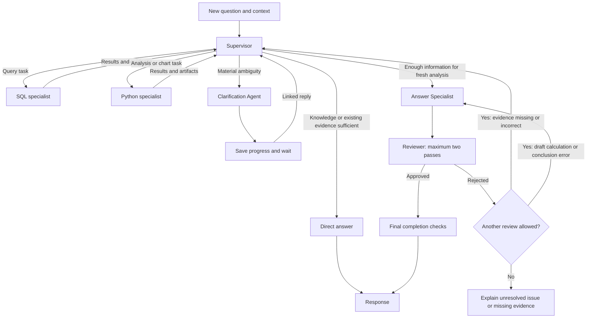

# Supervisor architecture

[Overall architecture](overall.md) · [PRD](../PRD.md) · [Decision log](../memory.md)

Evaluation, trace requirements and inference cost are covered in [Evaluation and observability](evaluation-observability.md). The [SQL Specialist contract](sql-specialist.md) defines its approved delegated action.

## Supervisor coordination

### Action model

Represent actions with a Pydantic Action model as well as the already agreed Task models. The shared Action fields are action_id (UUID) and type (the action discriminator). Concrete discriminator values, specialist-specific payloads, and any action subclasses will be defined with the concerned components. How terminal and clarification actions record outcomes and transition the graph is a pending design decision.

### Per-action outcomes

Use outcomes, a dictionary keyed by action_id. Each key holds the latest recorded outcome for that action. A task completes when each of its action IDs has a terminal outcome for the current dispatch, including failures and timeouts. Preserve successful sibling outcomes and retry only the failed action when a retry is warranted. Use at-least-once crash recovery: reuse checkpointed outcomes and replay unresolved actions when eligible. An action may have run before its outcome was saved, so make replayed effects idempotent or deduplicate them with a stable action identity. Keep action_id stable and give each deliberate retry after a recorded failure a new attempt number. The runtime accepts outcomes only for the expected attempt and checks task completion against that attempt. Crash recovery replays an unresolved attempt with the same number so effects can be deduplicated by action ID and attempt number. Supervisor state keeps the latest outcome and expected attempt number for each action. Keep earlier attempt history in traces for debugging, subject to the agreed trace data rules. Exact outcome fields and replay mechanics remain open.

### Task models and outcome collection

Task model decision: define a Pydantic task base class and subclasses for different task types. pending_tasks contains only waiting tasks. Its first entry is next. On dispatch, the runtime moves the full task from the head of pending_tasks to current_task. After all actions have recorded outcomes, the runtime clears current_task and the supervisor reassesses the queue before another dispatch. Detailed recovery and retry mechanics remain open. Concrete task payloads and polymorphic validation and serialization remain open. 

### Current task terminology

A task groups independent actions that may run concurrently. The supervisor can revise the ordered pending_tasks queue between dispatches. The outcomes dictionary keeps completed action outcomes separate from pending and active work. Direct answer, clarification, and answer handoff contracts remain open. 

Each submitted question has its own run state. A linked clarification reply resumes that original run. A new turn creates another run and can carry relevant confirmed context from earlier work.

The supervisor can return a Direct answer using general knowledge or verified context in its current model call. Data claims require evidence. Trace the two forms separately.

Use a bounded ReAct-style supervisor implemented with LangGraph. The supervisor owns initial routing, analysis planning, and delegation. It can answer general questions, reuse verified evidence, or invoke SQL and Python specialists for fresh analysis. This supersedes the earlier separate Router Agent design.

Specialists return observations to the supervisor. For fresh analysis, once it has gathered enough information, an Answer Specialist drafts the response from the evidence. The draft must pass the Reviewer before display. Missing or incorrect computed evidence returns the run to the supervisor. If evidence is sufficient but the draft has a calculation or conclusion error, return it to the Answer Specialist. Allow at most two review passes in total across the run, including the initial review. If the second review rejects the answer, end with a brief explanation of the unresolved verification issue and omit the rejected analysis. If evidence is missing, explain which claim could not be supported and what evidence is needed, using the reviewer findings. This supersedes the single-correction policy. When a review finds both evidence issues and draft errors, evidence issues take precedence and the run returns to the supervisor, subject to the two-pass limit. The reviewer reports only blocking problems with correctness, evidence, or fulfillment of the request. Wording and style preferences remain with the Answer Specialist. The Clarification Agent suspends work when user input is needed. Code enforces source access, budgets, and completion checks.

### Supervisor run context

The runtime supplies run_context before invoking the agent; it is read-only to the supervisor. The CLI supplies equivalent context without requiring Django. Preserve the original question here; the representation of interpreted intent and clarification-derived definitions remains open for memory and task-contract design. Eligible sources define the pinned access scope, while task evidence separately records sources actually used. The runtime checks authorization and source availability when dispatching work. Newly added datasets do not enter an existing run's scope; clarification resumes the same scope.

| Field | Type | Meaning |
| --- | --- | --- |
| run_id | UUID | Identifies this submitted question's run. |
| project_id | UUID | Identifies the Project containing its datasets. |
| chat_id | UUID | Identifies the Chat containing the question. |
| question | string | Original user question, preserved unchanged. |
| eligible_dataset_ids | list of UUIDs | Dataset snapshot IDs pinned at submission. |

UUID version, wire serialization, and CLI identifier conventions remain open. Other proposed supervisor state fields remain subject to their individual design discussions.

### Supervisor control decisions

The supervisor selects work through pending_tasks and the runtime dispatches the queue head into current_task. The graph determines what to execute from the actions in current_task. Action types and recorded outcomes drive the transitions, including graph-enforced mandatory review after a fresh draft. A separate routing decision field is unnecessary. An action that pauses or ends the run must be the sole action in its task, so it cannot interrupt sibling actions. Before dispatch, the runtime validates the proposed task. If the task is invalid, the runtime rejects it before any action starts and tells the supervisor which rule it violated. The supervisor can repair the plan within its normal decision budget. If that budget is exhausted, follow the agreed stopping rules. Concrete task and action schemas, remaining validation rules, and the validation error format will be defined with the relevant components. 

### Supervisor decision inputs

For each decision, give the supervisor the original question, relevant conversation context, metadata for eligible datasets, the pending plan, bounded summaries of action outcomes, and the remaining run budget. This defines the decision input, not additional persisted state fields. The memory design owns conversation context assembly.

### Evidence reuse and routing examples

Reuse prior evidence for a direct answer only when it supports the requested claim under the same dataset snapshots, metric definition, filters, period, and level of detail. Use few-shot examples in the supervisor prompt to demonstrate matching evidence reuse, fresh analysis when evidence is incompatible or insufficient, and clarification when ambiguity materially changes the answer. Ask for clarification only when the question and confirmed context leave a choice unresolved and choosing among plausible interpretations could materially change the answer. If plausible interpretations lead to the same substantive answer, proceed. Design the prompts, including the few-shot examples, after the component designs are complete. Refine the examples using routing evaluations.

### Supervisor execution boundary

The supervisor coordinates work without executing SQL or Python itself. It may inspect available dataset metadata and retrieve context. SQL and Python execution belong to their specialists.

### Specialist state and contracts

Each specialist has its own state. The supervisor supplies the inputs needed for its delegated task and receives its result. Define each specialist's state, input and result schemas, and mapping from supervisor state during that specialist's design discussion. The previously illustrated structured task payload remains a proposal; its fields are not approved.

### Failure handling and stopping

After a specialist task fails, the supervisor inspects the failure and may retry, change approach, or continue with available evidence within runtime-enforced limits. When further progress is impossible, return a useful supported partial answer where possible and explicitly identify what remains unanswered. Repeated actions without new evidence must stop with an explanation instead of continuing until timeout. Progress means obtaining usable new evidence, resolving an ambiguity, or completing a requested deliverable. A valid empty result counts when it answers a question about whether matching records exist. Repeating work that adds nothing does not reset the no-progress count. Exact budgets, retry limits, and the no-progress stopping threshold remain open for evaluation. Fresh partial analyses remain subject to the agreed Answer Specialist and Reviewer workflow and two-review limit. Reserve part of the run budget for drafting, review, and finalization. Before dispatching further analysis, enforce that reserve. When analysis reaches the reserve, hand off a useful supported partial answer if possible. If the evidence cannot support a useful answer, explain what is missing. Choose the reserve size through evaluation. Immediately before publishing any answer, check the run for source invalidation under the agreed source-removal rule and for expiration of the hard deadline. If either condition applies, withhold the answer and show the applicable source-unavailable or timeout message. Reviewer approval does not override these checks.

### Execution limits

See [Evaluation-driven execution limits](evaluation-observability.md#evaluation-driven-execution-limits).

### Completion without duplicated outcomes

Do not add a separate requested_outcomes field to supervisor state. Before answer handoff, the supervisor checks the original question against outcomes and remaining work in pending_tasks. An empty queue alone does not establish completion. The representation of confirmed definitions and filters remains open for memory and task-contract design.

### Revisable task plan

The supervisor can add, revise, reorder, or remove pending tasks between dispatches within run limits. A task can run only when its prerequisites are satisfied. Apply the existing retry policy to a failed prerequisite action. If it succeeds on retry, dependent work can proceed. If the action is ineligible for retry or its retries are exhausted, the supervisor uses the failure in outcomes to revise the plan. Before dispatch, the runtime blocks a queue head whose required results are missing and returns control to the supervisor. This prerequisite check does not trigger a retry. Keep outcomes separate from the queue so replanning preserves gathered evidence. Exact dependency tracking and checkpoint behavior remain open. 

### Parallel delegation

Between dispatches, the supervisor identifies independent actions that can run concurrently within one task. Dependent actions wait for the results they need. Actions have isolated outputs, and the execution layer enforces a shared run budget and concurrency capacity. The exact capacity remains open.

Define the supervisor's input context, specialist task and result contracts, and loop budgets in the following design rounds.
