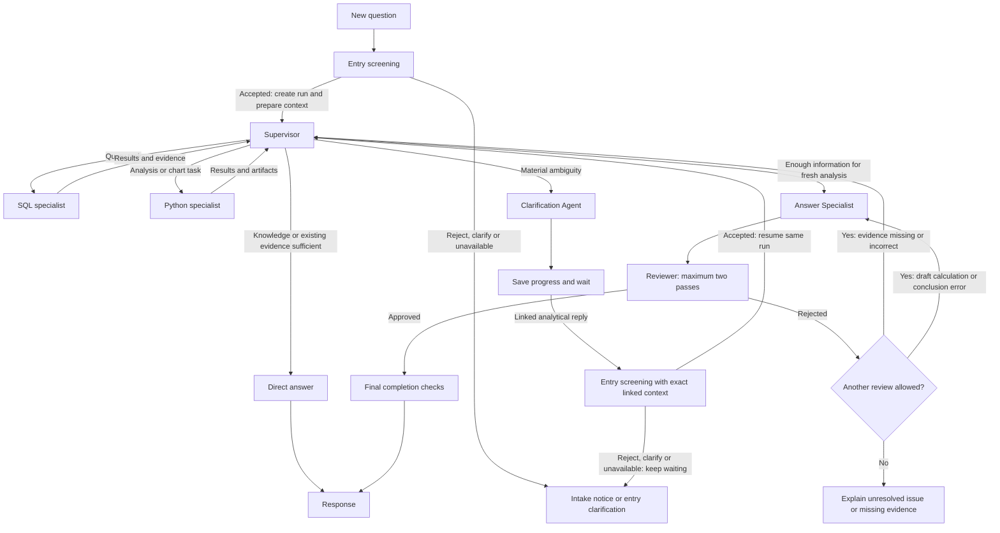

# Supervisor architecture

[Overall architecture](overall.md) · [PRD](../PRD.md) · [Decision log](../memory.md)

Evaluation, trace requirements and inference cost are covered in [Evaluation and observability](evaluation-observability.md). The [SQL Specialist contract](sql-specialist.md) defines its approved delegated action.

## Supervisor coordination

### Action model

Represent actions with a Pydantic Action model as well as the already agreed Task models. The shared Action fields are action_id (UUID) and type (the action discriminator). Component payloads and Direct/Clarification semantics are approved in their contracts. Integration rounds 5C1–5C2 define propose_queue/stop supervisor decisions, local proposal keys, runtime-issued IDs, guarded committed task handoffs, interpretation/obligation updates and finite control candidates. Models cannot write ownership, counters, parent output or an arbitrary next_node. Canonical encoding/transactions remain round 6.

### Per-action outcomes

Use outcomes, a dictionary keyed by action_id. Each key holds the latest recorded outcome for that action. A task completes when each of its action IDs has a terminal outcome for the current dispatch, including failures and timeouts. Preserve successful sibling outcomes and retry only the failed action when a retry is warranted. Use at-least-once crash recovery: reuse checkpointed outcomes and replay unresolved actions when eligible. An action may have run before its outcome was saved, so make replayed effects idempotent or deduplicate them with a stable action identity. Keep action_id stable and give each deliberate retry after a recorded failure a new attempt number. The runtime accepts outcomes only for the expected attempt and checks task completion against that attempt. Crash recovery replays an unresolved attempt with the same number so effects can be deduplicated by action ID and attempt number. Supervisor state keeps the latest outcome and expected attempt number for each action. Keep earlier attempt history in traces for debugging, subject to the agreed trace data rules. Exact outcome fields and replay mechanics remain open.

### Task models and outcome collection

Task model decision: define a Pydantic task base class and subclasses for different task types. Approved integration round 5C1 defines committed task_id/type/requires/actions; types are analysis, answer, clarify and direct_answer. Analysis actions are independent SQL/Python delegations; control tasks have exactly one action and are admitted as the sole waiting task with no active current_task. Supervisor replaces the full waiting queue under expected_queue_revision validation, retaining unchanged task references or proposing new tasks. Runtime validates atomically, assigns identities and dispatches the queue head as immutable current_task. After all expected analysis attempts are terminal, it preserves siblings, clears current_task and returns to supervisor. Review/wait/publication follow mandatory runtime edges. Canonical serialization and recovery transactions remain round 6.

### Current task terminology

A task groups independent actions that may run concurrently. The supervisor can revise the ordered pending_tasks queue between dispatches. The outcomes dictionary keeps completed action outcomes separate from pending and active work. Direct answer and analytical Clarification semantics are approved in integration rounds 5A–5B; decision/task dispatch and interpretation/completion/progress contracts are approved in 5C1–5C2. Answer/Reviewer component handoffs and correction routing remain mandatory; canonical runtime wiring remains round 6.

Each submitted question has its own run state. A linked clarification reply resumes that original run. A new turn creates another run and can carry relevant confirmed context from earlier work.

The supervisor can return a complete Direct answer using relevant analytics/SQL/statistics or Querivue-help knowledge or verified context in its current model call. Approved [integration round 5A](agent-integration.md) reuses Answer's typed blocks/value/chart references and display policy, permits at most one bounded format/reference correction, and forbids Direct after SQL/Python dispatch in that run. No new Project arithmetic or on-demand retrieval; profiles must already be supplied as valid typed evidence. Runtime fences immutable active candidates and publishes idempotently only with valid full pinned scope, answer dependencies, ownership and deadline. Direct inherits all source-bearing originating/retained correction context and carries no Reviewer-approval label. Trace knowledge/evidence forms separately. Approved entry screening precedes admission and linked-reply resume; its entry-policy clarification is separate from analytical clarification. Under round 2B2, the tool-free assessor may make the first model call; supervisor remains the first planning agent. Linked replies carry their exact question context; internal clarification handoffs do not add a separate semantic assessment.

Use a bounded ReAct-style supervisor implemented with LangGraph. The supervisor owns initial routing, analysis planning, and delegation. It can answer relevant analytics/Querivue questions, reuse verified evidence, or invoke SQL and Python specialists for fresh analysis. This supersedes the earlier separate Router Agent design.

Specialists return observations to the supervisor. For fresh analysis, once it has gathered enough information, an Answer Specialist drafts the response from the evidence. The draft must pass the Reviewer before display. Missing or incorrect computed evidence returns the run to the supervisor. If evidence is sufficient but the draft has a calculation or conclusion error, return it to the Answer Specialist. Allow at most two review passes in total across the run, including the initial review. If the second review rejects the answer, end with a brief explanation of the unresolved verification issue and omit the rejected analysis. If evidence is missing, explain which claim could not be supported and what evidence is needed, using the reviewer findings. This supersedes the single-correction policy. When a review finds both evidence issues and draft errors, evidence issues take precedence and the run returns to the supervisor, subject to the two-pass limit. The reviewer reports only blocking problems with correctness, evidence, or fulfillment of the request. Wording and style preferences remain with the Answer Specialist. The Clarification Agent suspends work when user input is needed. Code enforces source access, budgets, and completion checks.

### Supervisor run context

Approved [integration round 5B](agent-integration.md) defines analytical Clarification: supervisor supplies one material unresolved issue, tentative candidates, constraints and authorized evidence/context to a private tool-free agent. It returns question_ready, blocked or failed. Runtime owns immutable active question/waiting records, entry-screened one-reply admission and exact same-run/snapshot resume. Two nonrefundable generation slots/run permit at most two physical requests each (repair OR retry), under candidate 8,192 input/1,024 generated tokens, 15-second slot and 10-second request ceilings. An unresolved accepted reply returns here for a remaining slot or bounded completion/partial/stop, never inferred consent. Pinned-source removal and hard expiry invalidate waiting; Direct/review counters survive. Round 5C2 adds a candidate 15-minute wait expiry, shortened when the hard deadline or required resume/finalization reserves bind, and bounded linked intake. Canonical transactions and configured spending controls remain gates.

The runtime supplies run_context before invoking the agent; it is read-only to the supervisor. The CLI supplies equivalent context without requiring Django. Preserve the original question unchanged. Under approved round 5C2, ordinary supervisor decisions may propose versioned interpretation and obligation updates linked to exact admitted user-message or accepted-clarification spans, scope, source dependencies and superseded records. Runtime validates IDs, cutoff, byte locators, exact quotes and provenance; the quote remains authoritative, while model-normalized meaning remains an attributed interpretation, not runtime-certified user confirmation. A material inferred meaning or conflict requires clarification. The obligation projection retains original and linked-reply wording and records explicit changes/withdrawals without adding a tenth parent-state field. Eligible sources define the pinned access scope, while task evidence separately records sources actually used. The runtime checks authorization and source availability when dispatching work. Newly added datasets do not enter an existing run's scope; clarification resumes the same scope.

| Field | Type | Meaning |
| --- | --- | --- |
| run_id | UUID | Identifies this submitted question's run. |
| project_id | UUID | Identifies the Project containing its datasets. |
| chat_id | UUID | Identifies the Chat containing the question. |
| question | string | Original user question, preserved unchanged. |
| eligible_dataset_ids | list of UUIDs | Dataset snapshot IDs pinned at submission. |

Integration round 2 selects UUIDv4 for new runtime UUID identities and canonical lowercase hyphenated UUID wire strings, preserving valid supplied IDs. Round 5C1 approves the logical control-task shapes; exact canonical serialization, CLI input conventions and recovery wiring remain later contracts. Parent state ownership is approved in the integration specification.

### Supervisor control decisions

The supervisor selects work through pending_tasks and the runtime dispatches the queue head into current_task. The graph determines what to execute from the actions in current_task. Action types and recorded outcomes drive the transitions, including graph-enforced mandatory review after a fresh draft. A separate routing decision field is unnecessary. An action that pauses or ends the run must be the sole action in its task, so it cannot interrupt sibling actions. Before dispatch, the runtime validates the whole proposed queue and linked interpretation/obligation updates atomically. An invalid proposal starts no action and receives bounded validation feedback; retries and repairs spend the shared decision budget. Control handoffs, stops and withdrawn work require an obligation_check covering each operative request as supported, missing, unresolved or explicitly withdrawn by the user, with validated support/gap references. Task withdrawal or an empty queue cannot erase a requested calculation or chart. Canonical validation errors and transactions remain round 6.

### Supervisor decision inputs

For each decision, give the supervisor the original question, relevant conversation context, metadata for eligible datasets, the pending plan, bounded summaries of action outcomes, and the remaining run budget. This defines the decision input, not additional persisted state fields. Approved integration round 3 limits conversational continuity to the Chat and freezes its visibility at submission receipt. Later completions cannot silently change the run's interpretation. Linked analytical replies extend their exact waiting run's snapshot; source eligibility remains independently enforced. Run-local overrides do not replace continuing defaults. Approved rounds 4A–4B build explicit runtime packets from linked records, thread context/defaults and bounded tentative recent-thread candidates, with actual permitted values, provenance and omission markers. They add no retrieval/summarizer model call. Required context cannot be silently dropped; full draft/review/repair capacity is preflighted before drafting. Deterministic compaction has a candidate 75% trigger and one rebuild per invocation; at most two supervisor replans address the same unresolved overflow condition. Supervisor's per-request ceiling is 16,384 input/4,096 generated tokens; round 5C2 adds candidate cumulative limits of 12 substantive decisions, 2 repairs total (at most 1 per decision), 1 physical replacement, hence at most 14 logical/15 physical requests, 245,760 input/61,440 generated tokens and 120 seconds role elapsed. Direct's one format correction spends these same buckets. Exact model/provider/configuration, monetary caps and measured adequacy remain gates.

### Evidence reuse and routing examples

Reuse prior evidence for a direct answer only when it supports the requested claim under the same dataset snapshots, metric definition, filters, period, and level of detail. Use few-shot examples in the supervisor prompt to demonstrate matching evidence reuse, fresh analysis when evidence is incompatible or insufficient, and clarification when ambiguity materially changes the answer. Ask for clarification only when the question and confirmed context leave a choice unresolved and choosing among plausible interpretations could materially change the answer. If plausible interpretations lead to the same substantive answer, proceed. Design the prompts, including the few-shot examples, after the component designs are complete. Refine the examples using routing evaluations.

### Supervisor execution boundary

Approved integration round 1 uses one outer run execution and private SQL/Python/Answer/Reviewer subgraphs invoked through explicit runtime wrappers. Independent analysis actions can run concurrently; Direct answer, clarification, drafting/review and finalization use a serial control path after current analysis settles. Runtime owns mandatory review/correction/publication edges. A first draft-only rejection dispatches Answer directly without another supervisor model decision; evidence/mixed rejection returns here. Terminal Reviewer failure and second rejection stop; failed Answer invocations retain bounded supervisor failure handling. See [agent integration](agent-integration.md) for boundaries; state/memory/recovery details remain later rounds.

Reviewer design review is closed through round 6. Reserve future capacity before drafting; consume a nonrefundable pass/start its timer only when that review is admitted and atomically reserved. Base review packets remain frozen across repair, with separate per-invocation payload digests. Restore valid completed verdicts without new calls or timer resets; unresolved expired work cannot become approval, and current source/active-candidate/run-deadline gates still control publication. Memory/context policy, canonical runtime contracts, built evaluation configuration and live checks remain prerequisites.

Reviewer round 4 uses nonrefundable durable pass reservations and immutable outcomes. Bounded recovery/repair precedes terminal failure; a terminal failed/incomplete review stops the flow on either pass rather than consuming pass 2 to repeat it. Its provisional run ceiling is five physical requests with one shared retry, within two 30-second elapsed passes; drafting admission retains 60 seconds for reviews plus 5 for finalization and configured worst-case token/cost exposure. These are intersecting unmeasured ceilings, not guaranteed retry time. See [Reviewer](reviewer.md) for complete accounting and gates.

Answer Specialist and Reviewer are independent agents deciding from their explicit supplied context and role instructions. The runtime passes bounded typed handoffs; it does not merge their model conversations or expose unsupplied internal working state/history. Drafts and feedback do not become computed evidence merely through handoff. Each agent reports context gaps rather than presuming missing facts; the Reviewer forms its own verdict.

The approved Answer Specialist handoff uses immutable draft/review identities and frozen rendered evidence packets. Its draft dependencies include all supplied source-bearing context/evidence, including prior drafts/feedback; final answers also retain approving-review dependencies. Selected citations cannot narrow that dependency union. The runtime serializes source invalidation and final publication through the shared authority and rechecks exact active approval/deadline. See [Answer Specialist](answer-specialist.md).

The supervisor coordinates work without executing SQL or Python itself. It may inspect available dataset metadata and retrieve context. SQL and Python execution belong to their specialists.

### Shared parent state

Approved integration round 2 defines input, context, evidence, messages, pending_tasks, current_task, outcomes, execution_status and output. Runtime maintains evidence[evidence_id] as the run registry; outcomes retain approved terminal results, durable result references and selected evidence/chart IDs. The supervisor receives actual bounded typed values in derived context.evidence, not only IDs. Private child state is not merged into the parent. Task/action/expected-attempt/owner guards preserve siblings and reject stale/conflicting writes; checkpoints are projections of durable authority. New runtime UUID identities use UUIDv4/canonical wire strings while supplied IDs retain their identities. Full logical control and memory records are in [agent integration](agent-integration.md); canonical transaction/encoding and checkpoint recovery APIs remain round 6.

### Specialist state and contracts

Each specialist has its own state. The supervisor supplies the inputs needed for its delegated task and receives its result. Define each specialist's state, input and result schemas, and mapping from supervisor state during that specialist's design discussion. The previously illustrated structured task payload remains a proposal; its fields are not approved.

### Failure handling and stopping

After a specialist task fails, the supervisor inspects the failure and may retry, change approach, or continue with available evidence within runtime-enforced limits. An optional progress_report in the next ordinary SupervisorDecision covers only the preceding completed cycle, cites validated outcomes/replies/deliverables and is applied once. Progress means usable new evidence for an operative obligation, resolution of relevant ambiguity, or completion of a requested deliverable; a valid empty result can qualify when it answers a no-match question. New IDs, duplicate results, cosmetic queue edits, failed corrections and unanswered clarification do not reset the durable counter. Missing/invalid reports cannot reset it. Round 5C2 selects a candidate stop after two consecutive non-progress cycles: no further analysis/replanning, but a supported Direct or reviewed Answer handoff may still proceed within remaining budgets. Fresh supported partial analyses require explicit supervisor partial authorization, actual unmet obligations in the runtime-resolved Answer packet and Reviewer approval; without useful support or review capacity, stop with a bounded notice. Reserve necessary supervisor, Answer, Reviewer and finalization capacity before further analysis and linked clarification waiting. Immediately before publication, source invalidation and hard-deadline checks override a candidate or Reviewer approval.

### Execution limits

See [Evaluation-driven execution limits](evaluation-observability.md#evaluation-driven-execution-limits).

### Completion without duplicated outcomes

Do not add a separate requested_outcomes field to supervisor state. Before answer handoff, compare each operative obligation from the immutable original question and accepted linked replies with outcomes, evidence/charts, gaps and remaining current/pending work. An empty queue alone does not establish completion. Complete Answer handoff requires compatible support for all requested deliverables and reserved draft/review/finalization capacity. For a useful supported subset with recorded gaps, the supervisor may propose partial_answer_allowed with a reason, unmet obligation/gap refs and support refs; runtime admits it only when consistent with actual facts and stopped/withdrawn work. Reuse AnswerAction's approved fields without adding a requested-output field. Answer's partial draft must disclose unmet deliverables and pass Reviewer; Direct remains complete-only. Stop reasons must match recorded gaps/no-progress or inability to complete; source-unavailable, timeout and terminal review failures take precedence.

### Revisable task plan

The supervisor can add, revise, reorder, or remove pending tasks between dispatches within run limits. Under approved 5C1, requires names committed in-run SQL/Python action IDs and exact expected attempts; runtime binds their canonical succeeded result refs and validates dependencies at dispatch. Failed/blocked/stale prerequisites do not satisfy the task, and the runtime returns a blocked-head reason rather than skipping ahead or retrying automatically. Eligible failed-action retry refs preserve request identity and successful siblings while runtime increments the attempt; consumers need a newly validated binding after that change. Bound artifacts must already exist at queue admission, so dependent SQL-to-Python work needs supervisor redelegation after publication. Dispatched snapshots are immutable. Canonical dependency/dispatch/checkpoint transactions remain round 6.

### Parallel delegation

Between dispatches, the supervisor identifies independent actions that can run concurrently within one task. Dependent actions wait for the results they need. Actions have isolated outputs, and the execution layer enforces shared run budgets and capacity. Round 5C2's unmeasured candidates allow at most 4 pending tasks, 2 independent actions per analysis task, 4 prerequisite refs per task, 2 concurrent analysis actions per run and 8 SQL/Python dispatch attempts per run, including at most 1 eligible deliberate retry per action. Run execution has a candidate 600-second active ceiling and a separate 60-minute hard wall deadline from analytical admission. Human clarification waiting pauses active time but never the wall deadline; each question's wait is at most 15 minutes and ends earlier when the deadline or safe reply point with required reserves binds. Linked analytical replies allow at most 2 intake chains/question, 4/run, under the existing entry-chain request bounds. Associated initial and linked entry charges count once toward candidate aggregate 1,250,000 input/190,000 generated tokens/run. Tighter role, time, cost, source and reserve limits may bind first.

Round 5's shared supervisor context, task/control handoffs, interpretation/completion/progress and finite candidate bounds are approved design. Reuse approved specialist request/result contracts. Canonical record encoding, transactions, checkpoint/ledger recovery and ownership races remain round 6; exact model/provider/prompt, monetary/resource caps, configured spending, measured suitability and live safety checks remain prerequisites before execution. No runtime implementation or implementation-ready claim follows from this design approval.
